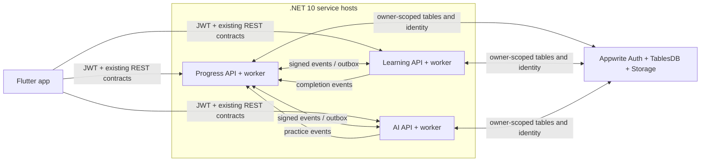

# Kế hoạch chuyển backend CocEnglish sang .NET

Ngày rà soát: 2026-11-05. Kế hoạch này triển khai ADR-0020 và dùng `operations.json` cùng `runtime.json` làm checklist nguồn.

## Phạm vi và nguyên tắc

- Chuyển đủ 91 operation đã khai báo trong OpenAPI, các consumer event, job và worker của ba owner Progress, Learning, AI.
- Dùng .NET 10 cho ba API host. Giữ nguyên Flutter, OpenAPI, Appwrite Auth/TablesDB/Storage, row ID, quyền sở hữu dữ liệu và HMAC giữa service. Khai báo schema trong repo hiện đã được đồng bộ cục bộ với các mode OpenAPI/Node; chưa so sánh hoặc áp dụng thay đổi lên project Appwrite.
- Giữ Node làm baseline so sánh và phương án rollback. Mỗi owner chỉ có một runtime được quyền ghi dữ liệu và chạy worker tại một thời điểm.
- Không thay đổi nghiệp vụ để làm vừa với .NET; không tạo shadow write. Chưa bật thanh toán/provider trả phí, áp dụng schema cloud, deploy hoặc push trong phạm vi này. Mọi chênh lệch live schema phải được chủ repo review trước khi áp dụng.
- OAuth, đăng nhập và khôi phục mật khẩu tiếp tục thuộc Appwrite Auth; .NET xác minh danh tính qua `Account.get` và vẫn phải giữ cô lập dữ liệu theo user.
- Giữ hành vi từ vựng/ôn tập hiện có: lịch ôn cập nhật theo kết quả và việc dùng gợi ý; ôn lại không được tạo XP vô hạn. Chấm giọng nói chỉ trả kết quả khi có assessment thực và đạt các cổng chất lượng, quyền riêng tư, chi phí.

## Kiến trúc đích

Node được giữ ngoài runtime đích để chạy differential fixture và rollback; không cho Node và .NET cùng ghi dữ liệu production của một owner.

## Hiện trạng theo ma trận

| Owner    | Operation | Đã có test local | Một phần | Còn pending |
| -------- | --------: | ---------------: | -------: | ----------: |
| Progress |        55 |               55 |        0 |           0 |
| Learning |        25 |               25 |        0 |           0 |
| AI       |        11 |               11 |        0 |           0 |
| **Tổng** |    **91** |           **91** |    **0** |       **0** |

Ma trận operation ghi nhận code và test local, chưa phải nghiệm thu service. Các session Learning có parity cho foreign-owner, replay, revision conflict và persisted rows; bốn job Progress có route/worker tests cùng fixture Node/.NET. Runtime worker, durable Appwrite, mixed-runtime, topology single-worker, Docker, Flutter/native và rollback được theo dõi riêng trong `runtime.json` và vẫn cần nghiệm thu; năm gate hệ thống còn đóng.

## Các giai đoạn

Fixture Progress 573 bước đối chiếu thêm public profile, follow/unfollow, mutual friends, lọc bạn riêng tư/bị block và cursor qua candidate bị ẩn; hai trang activity cursor gồm sự kiện cùng thời điểm; boundary của `listFriends`/`listActivity` cho limit 0/100/101, query limit lặp hoặc dạng số mũ, cursor offset -1/99999/100000; league ranking theo XP, timestamp và user ID, bỏ member bị loại dù XP cao hơn; friend-quest opt-in bỏ qua bạn private, solo quest đã claim và ứng viên thiếu solo, giữ solo progress của ứng viên được ghép; CHILD/deleted account bị từ chối; `sendInteraction` đối chiếu đủ năm kind thành công và qua local midnight Honolulu để tách cùng context thành hai ngày; `buyFreeze` với thiếu gem, đúng giá 20, replay cùng key, ngưỡng capacity streak 364/365 và đầy slot; xác nhận lỗi không tạo ledger/receipt; `claimQuest` với period sai, quest lạ và quest chưa hoàn tất, xác nhận không đổi dữ liệu; `listShop`/`buyItem` với inventory chạm maxOwned và `activateBoost` thiếu inventory, xác nhận lỗi không ghi; purchase/refund notification replay và payload conflict, terminal refund, cùng thông báo mới hơn/bằng/cũ hơn, chuẩn hóa ngày overflow theo JavaScript và từ chối ngày sai; gift ownership, redeem-once và entitlement hết hạn tại `now` hoặc không hạn, cùng rewarded-ad replay không phát thưởng lần hai; fixture cũng kiểm tra event được tạo và replay bởi user miễn phí, từ chối dùng lại event ID từ user khác, premium hết hạn đúng now, giới hạn 20 impression và reset theo ngày Honolulu; referral counters bao phủ ISSUED/ACCEPTED/QUALIFIED/REWARDED/EXPIRED, active MAX invitee được giữ nguyên và expiry đúng now nhận trial; promo null/exact expiry, inventory cap 999 và code không giới hạn số lần; thành viên gia đình kế thừa entitlement không hạn và xử lý hạn đúng tại `now`, cùng chủ nhóm xóa user không còn trong nhóm. Bước cuối dùng row driver test-only để mô phỏng achievement legacy thiếu/null `earnedAt`; `GET /v1/me` giữ thứ tự Node cho các giá trị này và year review 2024 chỉ đếm mục có ngày thuộc năm đó; league result/seen còn đối chiếu body sai định dạng, field lạ, tuần cũ và cả hai route sau khi hồ sơ bị xóa. Ba ca cuối bổ sung kiểm tra classroom join từ chối mã Unicode dạng full-width/FEFF/NBSP theo đúng lỗi Node, year review tại ranh giới nửa đêm Honolulu 2026 và năm thấp nhất hợp lệ (2019 bị từ chối, 2020 được lưu). Ca streak-repair bổ sung mismatch, ngày quá cửa sổ, nhánh nối tiếp streak đúng tại biên 2 ngày, thiếu gem/item, thanh toán và replay bằng item, payWith không hợp lệ, cùng từ chối hồ sơ đã purge. getEntitlement đối chiếu row vắng mặt, MAX không hạn, CANCELED còn hiệu lực, GRACE sát hạn, HOLD/REVOKED/EXPIRED và expiry đúng tại now; các GET không ghi row. Đây vẫn là bằng chứng cục bộ qua Node strict-memory adapter và .NET controlled row driver.

Ghi chú nghiệp vụ phát hiện trong baseline Node: redeem gift cho MAX/ACTIVE có `expiresAt: null` giữ plan/source nhưng đặt hạn mới `now + duration`; hạn đúng bằng `now` được coi là hết và entitlement nhận plan/source từ gift. Fixture khóa parity hiện tại; nếu sản phẩm muốn MAX không hạn tiếp tục vô hạn sau khi nhận gift, đó là thay đổi nghiệp vụ cần xử lý riêng ở cả hai runtime. Promo cũng giữ hành vi Node: active MAX không hạn giữ plan/source nhưng được đặt expiry mới; exact-now bị coi là hết hạn; grant vật phẩm chạm 999 nhưng ledger giữ nguyên delta yêu cầu; maxRedemptions null cho phép tiếp tục redeem và tăng redeemedCount. Đây là ghi nhận parity để review nghiệp vụ riêng, không phải thay đổi trong migration.

### 0. Khóa baseline và nền tảng .NET — phần lớn đã có

**Đã có:** ba host ASP.NET Core, contract/error catalog sinh từ OpenAPI, xác minh Appwrite identity, HMAC, Appwrite TablesDB transaction adapter, Docker/CI foundation và test dùng HTTP handler/row driver có kiểm soát.

**Việc còn lại:** giữ generator và Node fixture không lệch; mỗi thay đổi nghiệp vụ chạy test mục tiêu rồi test toàn solution. Không coi liveness/container smoke là bằng chứng dữ liệu bền vững.

**Cổng ra:** từ repo root, build/test .NET xanh; node backend-dotnet/tools/generate-contracts.mjs --check, node tools/blueprint/validate-schemas.mjs, node tools/blueprint/generate-dart-contracts.mjs --check, các fixture generator --check và node backend-dotnet/tools/check-operation-parity.mjs đều xanh; host unconfigured vẫn fail-closed.

### 1. Hoàn tất Progress

1. `consumeEvent` đã có test HMAC sender, replay, payload conflict, fail-before-write và Node/.NET differential cho ba consumer. Mixed-runtime event boundary và transaction recovery trên Appwrite còn pending.
2. Bốn job đã có route ký HMAC và dùng chung `ProgressJobRunner` cho HTTP lẫn worker. Worker opt-in bằng `COC_PROGRESS_WORKER_ENABLED=true`, chạy cadence Node, tuần tự hóa tick, tiếp tục sau lỗi và hủy khi host shutdown. Node/.NET job fixture đối chiếu rollover theo Pacific/Honolulu và Pacific/Kiritimati ngay sau UTC midnight, cùng freeze protection, streak loss và tick lặp; giới hạn catch-up 400 ngày với lần chạy tiếp theo xử lý ngày kế tiếp; ngày lưu sai định dạng được báo retry mà không thay đổi ví. Settlement giữ cohort ở `SETTLING` khi watermark còn pending rồi đóng khi watermark bằng zero và không áp dụng kết quả lần hai. Fixture settle cohort đủ 10 người, kiểm tra hai timestamp cùng instant nhưng khác UTC offset, tie-break thứ hạng, tier movement, podium gem awards, cutoff đúng tại Monday 00:00 UTC và từ chối settlement ngay trước cutoff. Purge xóa reward và 81 activity row trong nhiều transaction, giữ tombstone; relay gửi envelope đến hai đích rồi ACK, thử lại event từ attempt 9 để xác nhận DEAD tại ngưỡng 10, lưu DEAD ngay khi receiver trả lỗi không retry được, và đối chiếu backoff attempt 1/2 với cùng jitter xác định. Rollover cũng có local tests cho ngày đủ điều kiện/ledger cũ, candidate cũ nhất, limit, skip và retry. Relay có local tests cho batch 20, chọn theo row ID và cancellation/lease recovery. Chỉ cấu hình worker trên một instance Progress; kiểm tra durable restart/lease recovery và vận hành single-instance còn pending.
3. Các differential local của bốn Progress job hiện được bao phủ; phần tiếp theo là kiểm chứng concurrency/lease recovery trên Appwrite bền vững và hosting single-worker.

**Cổng ra:** 55/55 operation có code và test local; fixture Progress hiện đối chiếu 573 bước, gồm các luồng nghiệp vụ đã chọn, pagination boundary cho friends/activity, league tie/exclusion, friend-quest selection và writer denial, đủ năm kind interaction với local-day boundary, cả bốn job, tám product mua mô phỏng, bảo vệ entitlement thuộc giao dịch mới trước giao dịch cũ bị refund, cập nhật CANCELED cho đúng giao dịch hiện tại mà vẫn giữ hạn dùng, nhánh expiry entitlement gia đình, xóa user không còn trong nhóm, capacity 5→6 thành công và lượt thứ bảy bị từ chối không ghi, hai request tranh ghế thứ sáu chỉ ghi một thành viên sau conflict/retry của row driver local, chủ gói SUPER tạo được nhóm SUPER, entitlement hết hạn đúng now bị từ chối, hai ranh giới expiry khi redeem gift và referral counters cho đủ trạng thái, rewarded-ad replay và foreign-owner conflict, premium hết hạn đúng now, giới hạn 20 impression và đổi ngày Honolulu, classroom Unicode validation, year review ở nửa đêm Honolulu cùng giới hạn năm 2020–2026, league result/seen với body sai định dạng, field lạ, tuần cũ và hồ sơ đã xóa, cùng follow ở ngưỡng 999/1000 khi bản ghi REMOVED không bị tính, profile/follow từ chối target đã purge còn unfollow vẫn chấp nhận im lặng, và streak-repair mismatch/expiry, đủ hai payment, continuing tại biên 2 ngày, replay và denial; entitlement không row/MAX vô hạn/từng trạng thái expiry; buyFreeze đúng giá, replay và hai ngưỡng capacity. Ca cạnh tranh nhóm gia đình ở trên dùng row driver giả lập; giao dịch bền vững trên Appwrite vẫn pending. Parity rộng cho mọi operation, lease/crash recovery trên Appwrite và worker trên hosting target vẫn là điều kiện nghiệm thu riêng.

### 2. Hoàn tất Learning

1. REVIEW start/resume/answer/complete đã dựng bundle động ưu tiên lỗi chưa giải quyết rồi từ vựng đến hạn, ký digest theo Node, lưu snapshot riêng tối đa 64 KiB và tiếp tục dùng snapshot sau khi content nguồn đổi; test HTTP xác nhận replay, trả lời và hoàn tất. Tám authored modes hiện đã được port: hoạt động giữ nguyên frontier và phát event hoàn tất; TEST_OUT/CHECKPOINT cần threshold do nội dung ký, gate fail không đổi enrollment, gate pass chỉ mở frontier, CHECKPOINT kiểm tra prerequisite; CLASH chỉ chấp nhận opponent được nội dung server khai báo. Test HTTP bao phủ các mode, metadata, grading, pass/fail và không thưởng; grader có fixture cho cả 12 exercise type, submission kiểm tra assisted/substituted và từ chối assessment ID khi provider chưa được nhận duyệt. Session resume cũng có local HTTP coverage khi bundle chỉ còn ở version nội dung đã phát hành trước. `LearningNodeParityTests.EnrollmentLifecycleSessionAndAnswerSequenceMatchesNodeResponsesAndRows` đối chiếu enrollment, placement, start outcomes của đủ 12 mode, get/answer/abandon, receipt replay và owner rows với router Node trên content `vi_en/v2`; parity bắt được và đã sửa thông điệp `NODE_LOCKED` khác nhau. `LearningNodeParityTests.AuthoredModeCompletionsMatchNodeResponsesAndEffects` so sánh 16 completion case qua HTTP, gồm đủ 12 mode, gate pass/fail, assisted mastery và review sai-lần-đầu/rồi-retry; so sánh response, frontier, lịch ôn, mistakes, receipt và outbox. Durable Appwrite concurrency và Flutter parity vẫn pending. Complete và offline completion có local HTTP tests cho receipt, regrading, progression, review effects và outbox.
2. Course list/manifest/bundle/path, enrollment lifecycle, review queue, vocabulary list, mistake/activity reads, report creation và maintainer publishing đều có local tests. Fixture Node/.NET 81 bước hiện đối chiếu course/path/energy reads, placement pass/fail, revival, chuyển course thành công và deactivation đúng enrollment đang active, replay idempotent, revision conflict không ghi, giữ nguyên enrollment user khác, foreign-user session read/answer bị 404 mà không ghi session/answer/receipt, start outcomes của đủ 12 session modes, offline log regrade/replay/conflict trên signed `vi_en/v2`, session/answer/abandon, study pages, report replay/conflict và owner rows; bốn bước cuối so sánh `/health`, unauthenticated `/ready` (401) và signed `/internal/outbox-watermark`, gồm PENDING/LEASED/DEAD trước cutoff nhưng bỏ ACK và event đúng cutoff. Fixture completion riêng so sánh 16 case trên content ký với authored mode, gồm đủ 12 mode, gate pass/fail, assisted mastery và review retry; response cùng các bảng session/enrollment/answers/review/mistakes/outbox/receipts phải trùng Node. Fixture publication đối chiếu bốn bước: publish, replay cùng key, từ chối version trùng và owner rows; publication cũng kiểm tra chữ ký/hash của manifest và bundle, maintainer gate, version row/course pointer trong transaction. Signed HTTP dispatcher fixture đối chiếu scheduler response, delivery report và outbox row đã ACK. Appwrite concurrency/storage, production key rotation/config và Flutter parity còn pending.
3. Hoàn tất ba consumer `account.deleted.v1`, `entitlement.changed.v1`, `energy.granted.v1`, cùng deletion acknowledgement và immediate relay. Fixture Node/.NET so sánh thêm 12 signed event deliveries qua cả ba consumer, gồm replay, payload conflict, revision cũ, sai producer, energy grant và xóa tài khoản, cùng response và owner rows. Learning outbox worker đã có vòng chạy nền opt-in, dùng chung runner với job route; fixture Node/.NET so sánh dispatcher retry→ACK và immediate-after-commit retry, gồm delivery reports/event ID và persisted outbox rows. Durable restart/lease recovery và single-instance hosting gate còn pending.
4. Bảo toàn lịch ôn, hành vi gợi ý, giới hạn XP replay và dữ liệu từ vựng của Node. Trước migration, `DATA_MODEL.md`/`foundation.json` thiếu enum TEST_OUT/CHECKPOINT/STORIES và hai cột metadata session dù OpenAPI/Node đã dùng chúng; khai báo trong repo đã được đồng bộ cục bộ. Chưa chạy schema apply; trước cloud acceptance cần chủ repo review schema plan và xác nhận project test tương thích.

**Cổng ra:** 25/25 operation có code và test local. Fixture lifecycle đối chiếu 81 bước, gồm đọc course/manifest/bundle/path và energy mặc định, placement pass/fail, revival, chuyển khóa học thành công, replay, revision conflict, cô lập owner, foreign-user session read/answer không ghi, start outcomes của đủ 12 session modes, giới hạn truy vấn dạng số mũ tương thích JavaScript, offline log regrade/replay/conflict, study pages, report replay/body-conflict, grading-error retry, abandon/replay, reset conflict, health/readiness và signed outbox watermark. Fixture completion đối chiếu 16 mode case cùng persisted rows; fixture publication có bốn bước; fixture outbox kiểm tra hai bước dispatcher và một immediate relay retry cùng persisted rows; signed HTTP dispatch kiểm tra response và row đã ACK; fixture consumer event đối chiếu 12 delivery và owner rows. Flutter và storage bền vững vẫn pending.

### 3. Hoàn tất AI

1. Cả 11 route AI có code và local HTTP tests. getCapabilities, tutor/hội thoại, lifecycle phiên, assessment và TURN speech đã có code cục bộ; provider Azure Pronunciation Assessment, AssemblyAI và Deepgram được kiểm thử bằng HTTP giả lập. Fixture 31 bước đối chiếu capabilities và voice-turn khi provider tắt, filtered history, tutor fallback/replay, entitlement denial, voice fail-closed, assessment missing/owned/foreign reads, roleplay có entitlement qua bốn authored turns đến completion/history, lịch sử hội thoại qua ba trang cursor với tie-break ID khi `startedAt` trùng nhau, heartbeat tăng đơn điệu, stale-epoch rejection, close replay và foreign-owner denial. Khi provider tắt, assessment lưu hash và null score, replay không tạo receipt thứ hai. Sáu fixture provider-on dùng WAV tổng hợp và phản hồi cố định để đối chiếu Azure assessment, Azure voice-turn, Azure lỗi→Deepgram/AssemblyAI assessment fallback, và cả hai fallback qua voice-turn; mỗi fixture so sánh request provider, replay và các hàng dữ liệu liên quan, không gọi mạng. Fixture assessment cũng đọc đúng thời điểm hết hạn 24 giờ để so sánh trạng thái `EXPIRED`. Các bước dispatcher Node/.NET retry/backoff→ACK, HTTP relay HMAC và immediate relay retry cũng có differential. Mọi đường provider hiện có parity cục bộ; chất lượng scorer thật, quota/idempotency trên storage bền vững, quyền riêng tư và chi phí thiết bị vẫn cần nghiệm thu. Mặc định provider vẫn tắt; .NET yêu cầu speech mode, credential hợp lệ và cổng admission riêng. Không có lời gọi provider thật hoặc điểm giả.
2. Trước khi bật provider thật cần nghiệm thu cấu hình/tài khoản ở môi trường kiểm soát, đánh giá chất lượng scorer, quota/idempotency trên storage bền vững và differential rộng hơn với Node. Chỉ bật live/turn/scoring sau cổng kiểm thử thiết bị, chất lượng, quyền riêng tư và chi phí.
3. Hai consumer `account.deleted.v1`/`entitlement.changed.v1`, AI outbox dispatcher với HMAC relay, immediate relay sau commit và worker định kỳ opt-in đã được port, có test HTTP/lifecycle local cho inbox, batch purge, retry/backoff, ack và fail-closed. Dispatcher retry→ACK, HMAC relay request/outcome và immediate-after-commit đều có Node/.NET differential; durable Appwrite concurrency/restart, mixed-runtime event boundary, hosting chỉ một worker và Flutter acceptance còn pending. Truy vấn purge dùng index `aggregateId,type`, đã khai báo trong repo nhưng chưa áp dụng cloud.

**Cổng ra:** 11/11 operation có code và test local; Azure primary và fallback provider paths có parity fixture cục bộ. Durable state, mixed-runtime event, kiểm thử chất lượng/riêng tư/chi phí thật và Flutter acceptance vẫn phải đạt.

### 4. Chứng minh parity và ranh giới event

- Chạy differential trên fixture Node và .NET với cùng seed/test identity, so sánh cả wire response lẫn bảng bị tác động.
- Fixture hiện có route coverage 91/91 operation: 55 Progress và 11 AI nằm trong luồng chính; Learning có 22 route trong lifecycle 81 bước và ba route phụ qua completion, publication, signed HTTP dispatch. Các fixture hiện có thêm 573 bước Progress, 16 Learning completion case, 12 signed Learning event deliveries, hai bước Learning dispatcher, một immediate relay case, 31 bước AI route, sáu provider-on speech cases, chín AI event deliveries, hai bước AI dispatcher, sáu response case HMAC relay và một immediate relay case khi speech/provider mặc định tắt; cộng bốn bước publication. Đây là coverage local qua controlled memory stores cho các luồng đã chọn, chưa phải nghiệm thu mixed deployment hoặc đối chiếu mọi nhánh đầu vào của cả 91 operation. `node backend-dotnet/tools/check-operation-parity.mjs` kiểm tra route coverage và test references trong ma trận.
- Bao phủ lỗi, null/field omission, request ID, timestamp, cursor, idempotency key, receipt replay, payload conflict, HMAC sender, transaction rollback và retry.
- Chạy từng cặp Node/.NET ở môi trường test cô lập để kiểm tra event tương thích hai chiều; không dùng shadow write và không dùng dữ liệu người học thật.

**Cổng ra:** không còn khác biệt ngoài sai khác đã được ADR chấp thuận và tài liệu hóa; không có consumer nào bỏ qua auth, inbox dedupe hoặc owner boundary.

### 5. Nghiệm thu Appwrite bền vững và Flutter native

- Dùng project `coccoc-test` đã chọn trước đây, với tài khoản test/phiên đăng nhập riêng khi môi trường sẵn sàng; không ghi API key hoặc mật khẩu vào chat, source hay log.
- Live runner đã chuẩn bị năm row probes cho cả ba owner (`l_active_slots`, `p_profiles`, `a_active_slots`), cùng kiểm tra client mới, revision conflict, concurrency và cursor/owner filter trên Learning. Probe Storage đã upload file tổng hợp nhỏ vào `learning-assets`, đọc lại qua adapter .NET rồi xóa file có xác minh marker; 10 test cấu hình/HTTP giả lập qua, probe live vẫn chờ key test và cần `files.read` cùng `files.write`. Probe outbox bổ sung đã được nối vào live runner: hai client, lease trước/đúng/sau hạn, worker mới ACK và worker cũ không ghi đè, chỉ chọn một event giả có marker và tự dọn; delivery giả không gửi xuống service khác. Local rehearsal qua, chưa chạy cloud. Còn cần nghiệm thu `Account.get`, quyền user, process restart/crash recovery và worker leases trên Appwrite thật.
- Bằng chứng local ngày 2026-11-04: toàn bộ Flutter widget/golden suite qua trên Ubuntu 24.04.4 với Flutter 3.47.0 (**1.645/1.645**). Lượt Windows trước đó có golden mismatch; baseline Linux của repo hiện qua. Kết quả này chưa phải kiểm thử Android/iOS end-to-end.
- Chạy Flutter Android/iOS end-to-end qua ba host .NET, bao gồm học online/offline, review, progress/economy, social, billing simulation, AI fallback và xóa tài khoản.
- Chỉ dùng dữ liệu test. So sánh live schema với khai báo đã đồng bộ trong repo trước khi nghiệm thu; chủ repo review mọi kế hoạch additive apply/cấu hình cloud riêng. Không tự chạy schema apply.

**Cổng ra:** năm gate trong `runtime.json` đạt bằng chứng tách biệt: durable owner storage, mixed-runtime event boundaries, all-.NET Docker, Flutter native end-to-end, one-writer cutover/rollback.

### 6. Chuẩn bị hosting, cutover và rollback

Thực hiện theo [runbook cutover và rollback](CUTOVER_RUNBOOK.md). Runbook đã có thủ tục và mẫu bằng chứng; chưa diễn tập, gate vẫn pending. `/ready` đóng mặc định; code chỉ mở khi host có Appwrite/business admission và `COC_<SERVICE>_READINESS_GATES` khớp chính xác đủ năm gate. Đây là operator attestation sau khi review bằng chứng, không phải bằng chứng tự sinh; hiện chưa được cấu hình vì các gate còn pending.

1. Chốt với chủ repo môi trường hosting hỗ trợ .NET 10 container, secrets, HTTPS, health/readiness, lịch worker và log/alert. Repo hiện có workflow CI và Docker local; chưa có bằng chứng workflow deploy production .NET.
2. Chạy release candidate trên test Appwrite; kiểm tra readiness chỉ mở khi tất cả admission gates đạt.
3. Cutover lần lượt từng owner: dừng writer/worker Node của owner đó, xác nhận không còn job đang chạy, bật .NET, kiểm tra smoke và metric; giữ Node artifacts để rollback.
4. Rollback: dừng .NET writer/worker trước, xác nhận đã ngừng ghi rồi bật Node. Không chạy hai runtime đồng thời, không reset learner data.

**Cổng ra:** có runbook, người chịu trách nhiệm, quyền hosting/secret, tiêu chí dừng và bằng chứng rollback trên test trước khi xin duyệt production cutover.

Quest tháng bổ sung đối chiếu kỳ cũ hoàn tất với `upgradeChest=true`, chỉ cấp một huy hiệu/activity và không cấp gem/ledger; replay cùng key hoặc key khác không cấp thêm. Kỳ sai định dạng và tháng chưa có row bị từ chối. Chest replay đã đối chiếu giữ nguyên 24 gem từ ledger lịch sử; ledger có gem bằng 0, sai quest hoặc bị thiếu đều trả lỗi và không đổi ví. Đường tạo chest mới đã có tám case Node/.NET với entropy kiểm soát tại ranh giới 63/64, đối chiếu response và toàn bộ row nghiệp vụ/receipt; cùng key hoặc key mới đều không reroll. Constructor công khai mặc định vẫn dùng entropy bảo mật.

Cửa hàng đã có differential cho đủ năm loại đang bán, catalog theo các mốc 0/19/20/49/50/99/100/150 gem, số lượng và replay, catalog cũ/vật phẩm lạ hoặc chưa bán, giới hạn inventory/freeze, refill thiếu tiền và đúng giá. Timer/XP boost đối chiếu nối tiếp cùng loại, replay, hết hạn/đúng thời điểm hết hạn và hết inventory. Snapshot giữ cả energy outbox; UUID yêu cầu xóa trong event chỉ được chuẩn hóa khi khớp UUID response xóa đã nhận. Không còn operation mang nhãn `full-domain-differential`; mọi gate cloud/native/cutover vẫn pending.

Activity đã đối chiếu tám loại lưu trữ, bài riêng tư của chính mình, lọc tác giả theo quyền riêng tư/CHILD/xóa/purge/block hai chiều/không còn follow, thay đổi riêng tư/unfollow tại lần đọc kế tiếp và viewer đã xóa. GET không ghi dữ liệu. Giữ hành vi Node giới hạn 99 follow và lấy candidate trước khi lọc: trang nhỏ có thể kết thúc dù còn bài hợp lệ cũ hơn; đây là điểm nghiệp vụ cần review riêng ngoài migration.

## Checklist hoàn tất

Rà source gần nhất xác nhận friend-streak đã có controller/application và completion hook ở cả lesson/practice. Những nhãn remaining cho mở rộng capacity/authorization/completion trong ma trận không được dùng để kết luận thiếu code hoặc tự đánh dấu nghiệm thu; cần kiểm chứng lại theo checklist khi người dùng cho chạy kiểm thử. Hướng hosting đã chọn VPS nhưng thông tin hệ điều hành/domain/TLS thực tế vẫn đang chờ.

Người dùng đã chọn VPS/server chạy Docker Compose. Đã thêm [unit systemd và hướng dẫn VPS](../docker/staging/vps/README.md), gồm bố trí release/metadata/private secrets, start với image có sẵn và thủ tục stop trước khi đổi release. Chưa cài/chạy unit hoặc kiểm thử; thông tin VPS/domain/TLS và quyền vận hành thực tế còn cần cung cấp.

Script đóng gói truyền commit vào build arg `BUILD_ID`; runtime image lưu build ID để health/log dùng mặc định cùng revision label và metadata. Env template staging đã bỏ giá trị build ID nhập tay. Chưa build hoặc kiểm tra chuỗi liên kết commit/image/health/log; mục này đã được ghi lại để chạy sau.

Shared host đã có middleware log completion event 1001 và meter `CocEnglish.Api` với request counter/duration histogram. Dùng operation và route mẫu; không đưa body/query/header/exception message vào log mới. Chưa build/kiểm thử hoặc cấu hình collector/dashboard/alert trên hosting; các mục này đã ghi ở checklist kiểm thử để sau.

Đã bổ sung nạp cấu hình `/run/secrets` tại startup trong shared host và overlay Compose mount file secret riêng cho từng service. Chưa build hoặc kiểm thử; phải kiểm tra precedence, quyền file của user non-root, nội dung lỗi, bảo mật log/env và rotation theo [checklist](VERIFICATION_PENDING.md).

Host chỉ còn nhận fallback `APPWRITE_API_KEY` trong môi trường `Development`; Staging/Production phải cấu hình `COC_<SERVICE>_APPWRITE_KEY` riêng cho từng owner. Việc này tách key test runner khỏi key runtime. Thay đổi chưa build/kiểm thử; mục kiểm tra fail-closed và cấu hình owner riêng đã được ghi trong checklist.

Đã bổ sung [runbook xoay Appwrite/HMAC key](KEY_ROTATION.md), tách key live probe khỏi ba owner key trên VPS và ghi trình tự receiver-first cho HMAC. Code signer nay yêu cầu chọn key ID tường minh khi một sender có nhiều key, tránh phụ thuộc thứ tự dictionary. Chưa xoay/revoke key, build hoặc diễn tập; active-key fail-closed, live probe, file permissions, container recreation và rollback vẫn nằm trong checklist nghiệm thu.

Chế độ thực hiện hiện tại: tiếp tục triển khai, tạm để kiểm thử/nghiệm thu lại theo yêu cầu người dùng. Bộ Compose staging và các env template đã được bổ sung nhưng chưa chạy. Theo dõi toàn bộ bước cần kiểm thử sau tại [VERIFICATION_PENDING.md](VERIFICATION_PENDING.md); hướng dẫn cấu hình ở [staging deployment](../docker/staging/README.md). Các bằng chứng test trước đó không áp dụng tự động cho artifact mới.

Đã bổ sung [workflow đóng gói image thủ công](../../.github/workflows/dotnet-images.yml) và [script build/publish](../tools/build-images.sh): build-only mặc định, publish GHCR chỉ ở job được chủ động chọn, ghi commit/image ID/digest và metadata cho đủ ba service. Chưa chạy syntax check, build, workflow hoặc publish; các bước này nằm trong checklist kiểm thử để sau.

Đã thêm [staging configuration preflight](../tools/check-staging-config.sh) cho VPS và gắn vào `ExecStartPre` của unit systemd để Compose không khởi động khi metadata, host URL hoặc file secret sai. Hướng dẫn chạy Compose thủ công dùng cùng project name và base + file-secret overlay, tránh tạo stack thứ hai hoặc bỏ mount secret. Script đọc cấu hình mà không `source` file, không in giá trị, từ chối image chưa pin digest, host HTTPS còn `.invalid`, credential để nhầm trong env, key Appwrite dùng trùng giữa các owner, và file secret thiếu/quyền host quá rộng; cuối cùng gọi `docker compose config --quiet` để parse cấu hình hợp nhất mà không in model đã resolve. Chưa chạy; cú pháp, các nhánh lỗi, quyền đọc của user container và kết quả không lộ secret cần kiểm tra trên Linux theo checklist.

- [x] 91/91 operation có parity evidence, không còn `pending` hoặc `partial` trong `operations.json`.
- [ ] Mọi consumer, job, worker và immediate relay có auth, idempotency, retry/dead-letter, bounded work và restart evidence.
- [ ] Differential Node/.NET, durable Appwrite, mixed-runtime boundaries, Docker, Flutter native và rollback đều đạt.
- [ ] Readiness mở theo đúng gate; không có Node/.NET writer hoặc worker trùng owner.
- [ ] Owner repo duyệt hosting, secrets, lịch cutover và thay đổi vận hành cần thiết.

Chưa được coi là chuyển đổi xong chỉ vì unit/integration tests xanh, image build được hoặc health endpoint trả 200.
