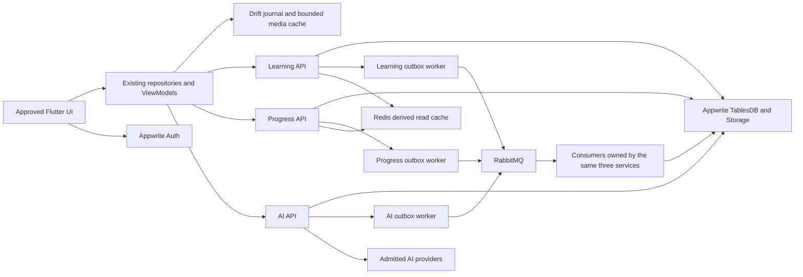

# Real features setup and integration plan — 2026-10-25

**Status:** human-approved for implementation on 2026-10-25; runtime work below is not complete. The human requested real functionality, preserved UI/UX, microservices, caching, an event bus/RabbitMQ, Docker and CI/CD. Real money payments remain excluded by the earlier explicit instruction. No deployment, schema apply, publishing or paid resource creation is performed by approval. CI/CD uses GitHub Actions. The human chose to retain Appwrite Auth after the [closed Descope evaluation](../architecture/adr/draft-0019-descope-identity.md); see the [selected stack](../architecture/STACK.md#approved-implementation-stack--2026-10-25).

**Goal:** every in-scope action uses verified identity and real durable state or an actual device capability, while retaining the approved Flutter appearance, routes and motion.

**Architecture:** retain Learning, Progress and AI and their existing write owners. Implement the approved container runtime, RabbitMQ event transport and Redis read cache through [ADR-0018](../architecture/adr/0018-container-event-cache-runtime.md). Appwrite Auth/TablesDB/Storage are retained by human choice; Drift remains the intended local journal. Reuse current email OTP, recovery and session adapters. Runtime admission and live delivery/device acceptance remain separate from design approval.

**Owners:** [SRS](../product/SRS.md), [OpenAPI](../api/openapi.yaml), [DATA_MODEL](../data/DATA_MODEL.md), [DESIGN](../design/DESIGN.md), [phase gates](IMPLEMENTATION_PLAN.md), [task protocol](TASK_PROTOCOL.md). This is a scoped execution map, not a replacement specification or a declaration that global phases passed.

2026-10-25 execution update: the human prioritizes functioning real features and implementation speed, accepts minor pixel differences, and still requires the approved layout/UX without large visual drift. Keep visual failures visible; do not spend the functional integration budget on matching every historical golden pixel. No golden baseline was rewritten.

## 1. Verified starting point

Inspection: local `main`, HEAD `2a411e44e89e74db483ab43ffa49796572c3c677`, with substantial existing tracked and untracked UI/backend changes. Preserve them. HEAD alone does not identify the UI candidate; first record the dirty-file and source-asset hashes as described in the [first slice](REAL_FEATURES_FIRST_SLICE_20261025.md).

| Evidence in current checkout | Consequence |
|---|---|
| `core/config/app_config.dart` defaults to `DataSource.mock`; API mode and public endpoint defines already exist | Build separate explicit preview and real candidates. Switching one define is not proof every feature is real. |
| `services/{learning,progress,ai}/src/index.ts` already select owner-local Appwrite adapters under configuration/admission gates | Reuse those adapters and handlers; do not rebuild three services from scratch. Check actual deployment/configuration independently. |
| OpenAPI contains 91 operations: Learning 25, Progress 55, AI 11 | Inventory each operation against its handler, repository, visible action and acceptance evidence. Operation count is not functional coverage. |
| `RealLearningSessionRepository` prepares identity/profile/path/rewards without fixture fallback; real learning, placement, mistakes, vocabulary, stats and speech acceptance receipts exist under `docs/quality/` | Reuse completed slices and close their hosted/device limitations. Do not reimplement approved screens. |
| `ApiAppShellRepository.stats` uses preview-derived values before its first server snapshot | The real shell needs an account-scoped valid snapshot or an existing loading/unavailable state, never invented current balances. |
| API account/settings/gift/call repositories still reference mock classes for some content or callbacks; phone verification and app icon providers include mock implementations | Trace the reachable behavior. Extract immutable UI copy from mock classes; replace simulated commands. A class name alone does not prove a data leak. |
| `core/cache/lesson_journal.dart` implements `LessonJournal` with SharedPreferences; Drift is not in the lock | Migrate behind this existing port, with transactional recovery and an explicit dependency/lock owner. |
| `services/ai/src/application/deps.ts` supports scripted/speech modes; `ApiCallRepository` can submit `turnPlaceholderWav` | Real AI acceptance must use captured audio or explicitly selected text, actual provider provenance and nullable scores. Scripted lines and placeholder silence are not live speech evidence. |
| Backend/mobile/Android/manual Appwrite deploy workflow files exist | Extend and harden existing pipelines; actual successful CI/deploy runs need separate receipts. Some Android actions are still pinned by mutable tags. |
| No Docker/Compose project files found; Docker CLI not found in PATH or the standard Desktop executable path | First verify supported Docker/WSL2 availability. No container run or install is claimed. |

Prior local UI/test evidence: [Android non-payment receipt](../design/qa/ANDROID_NONPAYMENT_COMPLETION_20261024.md). It records 179 backend passes/12 gated skips, the focused Android work, and 273 unresolved Windows Flutter baseline failures. These are historical results, not freshly rerun integration checks. Existing broad docs describing every adapter as absent are stale; update each canonical owner when its corresponding implementation is verified.

## 2. Scope and meaning of “real”

An operation is accepted only when a signed-in owner performs it against the admitted durable environment, survives restart/retry, rejects another user's identity, and renders the returned state through the existing UI. A failed network call must not return a successful fixture. Cached data must be account-scoped and identifiable as cached/pending through approved states.

Versioned authored lessons, translations, guides, legal copy, source illustrations, animation timelines and deterministic grading rules are legitimate product assets. Move mutable learner state, catalog availability, purchase effects, entitlement expiry, rankings and server rewards out of fixture paths. Do not replace curated lessons with runtime-generated AI merely to avoid constants.

| Feature family / existing locations under `apps/mobile/lib/features/` | Authoritative source / device | Work and acceptance | Wave / canonical task |
|---|---|---|---|
| Onboarding, goals, auth, recovery, saved account | Appwrite Account; Progress profile/preferences | Real registration/login/restore/Google configuration, cancellation, expiry and recovery; save actual goal. Guest preview stays explicitly isolated. | W2 / P3-AUTH-001, P3-AUTH-002 |
| Phone verification | Verified supported auth/OTP provider, server-side challenge | Replace fixed-code acceptance, enforce expiry/attempt limits and replay protection; account/region/provider proof before enablement. If no admitted provider, show existing unavailable state. | W2 / auth contract review |
| Profile/avatar, account/settings, export/deletion | Progress plus owner deletion acknowledgements | Revision conflicts, public/private projection, real persistence, account switch, deletion completion and local purge. Static avatar assets remain. | W2 / P3 and P9 social |
| Path, course switch/removal, guide, placement, enrollment | Learning, immutable signed content | Reuse actual course/path APIs and placement; fetch all pages; publish-pointer/hash verification; monotonic frontier and restart recovery. | W3 / P4-LEARN tasks |
| All twelve exercise types, answers/results, mastery/Legendary | Learning grading/session receipts | Correct/incorrect/assisted/skip, duplicate submission, completion uncertainty and real feedback; no client XP or unlock authority. | W3 / P5-LESSON tasks |
| Words, personal notebook, SRS, mistakes | Learning review state; existing local notebook port | Preserve local notebook behavior; verify durable per-account scheduling. Cloud notebook sync, if required, gets an explicit contract/storage task before implementation. | W3 / P6-REVIEW tasks |
| Stories, Radio, Adventures, Rapid, Side Quests, Clash | Learning authored activity sessions; Progress reward consumer | Real activity progress, resume, timer inventory and completion identity; unsupported session modes require contract-first work. | W3 / P7-PRACTICE-001 |
| XP, gems, score, streak/freeze/repair, milestones | Progress ledger/aggregates; Learning course progression | Ledger equality, timezone/day boundaries, no duplicate grants, pending reward reconciliation and multi-device reads. | W4 / P6-GAME tasks |
| Energy and legacy hearts display | Learning energy authority; active product policy | Reuse actual mode/capacity; default unlimited per current policy. No client refill or invented balance, no new monetization rule. | W4 / P6-GAME-003 |
| Shop, boosts, chest tiers/rewards, promo codes | Progress inventory/receipts/ledger; Learning energy via events | Server pricing/eligibility/debit/grant, stock and expiry, idempotent claim/redemption; use the implemented chest receipt rather than rerolling locally. | W4 / P6, P10-PROMO-001 |
| Quests/monthly/friend quests and league/tournament/result | Progress projections, workers and settlement watermark | Real eligibility, membership, claim, period roll, tie order and result acknowledgement; no mock roster or premature settlement. | W5 / P9 tasks |
| Friends/follow/feed, blocks/reports, friend streaks/interactions, classrooms, Year in Review | Progress owner-safe data | Actual users and visibility checks, pagination, idempotent interactions, block propagation, real period snapshots. | W5 / P9-SOCIAL tasks |
| Issue report / exercise report | Appropriate Learning or Progress owner after contract review | Submit durable report and return receipt; never display success from an in-memory report list. | W5 / contract gap task |
| Listening/audio speed/replay | Published media manifest and device playback | Actual playable assets, hashes, bounded download/cache, audio focus/interruption and text alternative. | W6 / P7-AUDIO tasks |
| Explain answer/tutor/Roleplay/call/assessment | AI capability/provider adapter, actual mic/playback | Authored explanation stays valid; real generation/recognition/scoring tested separately. Remove placeholder audio from the real path; no fabricated transcript/score. | W6 / P8 tasks |
| Super/Max feature access, reminder and promo-granted access | Progress entitlement revision; AI/Learning projections | Real eligibility/expiry and revocation, account-scoped reminder reconciliation and feature routing. A demo checkout cannot grant a production paid entitlement. | W4/W6 / P10-BILL boundaries |
| Family/gift/referral | Progress membership/redemption state | Real membership/invite/redeem effects with owner limits and duplicate safety. Monetary purchase initiation remains excluded. | W5 / Progress commerce |
| Dark mode, sound/haptics/accessibility, legal links, native sharing/app icons/reminders/widget | Local persisted preference or actual OS API; versioned documents | Implement real local/native actions without unnecessary backend calls; cancellation/permission denial/unsupported API paths. Android first. Existing iOS extension wiring needs its own device/build evidence. | W7 / P3 settings, P6 reminders, P11 |
| Real store payment and ad-network SDK | Excluded | Keep simulation isolated to demo/test. Do not auto-enable Play Billing, App Store billing, paid subscriptions or real rewarded ads. | Explicit prior exclusion |

This matrix groups screens; W0 must enumerate **every visible action and reachable route**, including less-used settings and profile variants, in a runtime register linked to the existing [flow checklist](../design/qa/FLOW_CHECKLIST.md). Completion marks for visual reuse must not be relabeled as live acceptance.

## 3. Target setup



The diagram is the approved target runtime, not deployed infrastructure. HTTP APIs and workers share each service's existing domain handlers; they can be separate processes from the same image. There are still three business services. `services/shared` stays transport/auth/ports only. Appwrite Auth remains managed infrastructure; no separate auth domain or provider migration is part of this scope.

Runtime details and cutover/rollback are owned by [ADR-0018](../architecture/adr/0018-container-event-cache-runtime.md). Docker Compose is the local integration topology. The production host, account quotas, TLS, worker hosting, broker/cache resources and budget must be recorded before an external deployment. A single-host Compose demo does not establish high availability.

## 4. UI/UX preservation contract

1. Snapshot the current dirty candidate, reference assets, route/action inventory and existing UI evidence before changing runtime wiring. Preserve the current browser preview build on :4173.
2. Implement real behavior behind existing repository interfaces and manual Riverpod ViewModels. Do not regenerate Flutter, relocate entire feature folders, redesign navigation or replace source art.
3. Compare mock and API-backed screens using identical canonical values and the same pinned device/fonts/viewport. Compare layout, color, spacing, interaction and animation separately from dynamic names/numbers.
4. Test loading, empty, denied, expired, offline, retry and pending states using approved component states. If a necessary state has no approved visual, record the gap and obtain a source/design decision before adding a new screen. Do not show fake success to preserve a screenshot.
5. Retain existing light/dark source hashes, reduced-motion behavior, gestures/back stack, text scale 2 and semantics. New UI code needs narrow/wide and actual Android captures; no blanket golden regeneration.
6. Run Flutter build/test/drive commands sequentially in this checkout. A separate build directory is required before any parallel Flutter jobs.

## 5. Execution waves and acceptance

Every wave uses claim → meaningful failing behavior test → minimal implementation → targeted checks → owner gates → evidence. Only W0 planning is completed by this document. Dependencies refer to evidence, not merely merged code. Full phase exits remain owned by IMPLEMENTATION_PLAN.

| Wave / dependencies | Concrete files and deliverables | Exit evidence |
|---|---|---|
| **W0 — inventory and freeze**; current task | Execute the [first-slice checklist](REAL_FEATURES_FIRST_SLICE_20261025.md); produce `docs/quality/real-features-20261025/{ui-baseline.json,runtime-register.json,environment-receipt.json}`. Reconcile scoped task records with current code. | Every visible action has owner/source/contract/test/status; dirty UI identified; mock vs real environments explicit; unresolved Windows failures preserved and triaged. |
| **W1 — durable runtime and integration foundation**; W0; architecture approved, runtime admission required | New `services/{learning,progress,ai}/src/runtime/{http,worker}.ts`, `infra/docker/{Dockerfile.service,compose.local.yaml,env.public.example}`, `.dockerignore`; update `tools/scripts/backend-check.mjs` and add `tools/scripts/runtime-check.mjs`. Reuse existing `http/wiring.ts`, owner Appwrite persistence and JWT verification. Start with current direct event transport. | Three API images survive restart with admitted durable storage; missing credentials fail closed; real JWT/private permissions/transaction conflict tests pass; memory/test modules absent from real bundles. An already admitted hosted runtime can support W2/W3 while new-container gates remain open. |
| **W2 — identity/profile**; W1 and P3 prerequisites | Existing `features/auth`, `account`, `profile`, `phone`, `core/api/client` and `services/progress/src/application`; environment platform/OAuth/recovery callbacks. Separate UI copy from mock mutations. | Two distinct real accounts; login/restore/logout/recovery, A→B switch, late requests and deletion tests; no email/private data leakage. |
| **W3 — content/learning/offline**; W2 and P4/P5 prerequisites | Existing `features/session`, `learning`, `placement`, `practice`, `vocabulary`, `core/cache/lesson_journal.dart`; new Drift adapter under `core/cache/`; existing Learning content/session/review modules and content validation tools. | Published pointer, signed bundle and full scoped curriculum validated; all twelve exercise types; complete twice grants once; one cached unit offline/kill/reconnect; answers/path/review converge. |
| **W4 — economy and progress**; W3 completion/event evidence | Existing `services/progress/src/application`, quest chest, `features/progress`, `results`, `quests`, `shop`, `promo`, `xp_boost`, `streak_repair`, `super_trial`. | Ledger totals, entitlement revisions, 100 duplicate/reorder cases, concurrent chest/promo/shop claims, midnight/DST/multi-device and stale-cache tests. No client balance authority or demo-paid entitlement. |
| **W5 — social/periodic workers**; W4 and P9 prerequisites | Existing Progress social/league/commerce workers and corresponding feature repositories; contract-first issue report gaps. | Opt-in/private/blocked/child tests, real cohorts, two-target fan-out acknowledgements, week close after consumer application watermark, one result/reward, membership/redeem limits. |
| **W6 — audio/AI**; W3 ordinary audio, W4 entitlement, P7/P8 prerequisites | Existing `core/audio`, learning audio store, `features/call`, `roleplay`, speech assessor and `services/ai` provider ports; capability configuration. | Real microphone/recorded bytes and provider provenance, permission/lifecycle/Bluetooth/interruption tests; null scores when unassessed; quota/timeouts; no paid adapter without approved allocation. Live native mode remains disabled until its own proof. |
| **W7 — native features and visual parity**; owning feature prerequisites | Existing `appearance`, `reminders`, `app_icon`, `legal`, platform files; source-backed fixtures and Android integration tests. | Actual OS actions and persistent settings; denied permission safe; same-source UI and animation comparisons; profile-mode traces on physical Android. iOS build/device evidence separate. |
| **W8 — CI/CD, recovery and release candidate**; W1 hardening starts early; final exit after W2–W7 | Extend `.github/workflows/{backend,mobile,android-e2e,appwrite-deploy}.yml`; add `containers.yml` and gated `runtime-deploy.yml` only when host is selected. Update [CI/CD](../devops/CI_CD.md), [operations](../devops/OPERATIONS.md), [release gate](../quality/RELEASE_GATE.md). | Same candidate SHA/digest promoted; required Linux tests green; actual Android install/smoke, backup restore, broker outage/drain/replay, Redis loss, schema compatibility and deployment rollback receipts. Publishing remains separate. |

**W1 transport/cache follow-up:** after W4 establishes direct-delivery ledger correctness, implement the proposed AMQP/Redis ports and application-receipt contract/storage in W1's runtime area. Run every ADR fault/settlement test before cutover. Ordinary real auth/course/lesson work does not wait for a new broker. W5 settlement and the final W8 candidate must be tested against the selected admitted transport.

### Exclusive interfaces and sequencing

One owner at a time for OpenAPI/generated DTOs, root router, either lockfile, schema/migrations, shared transport ports and global phase state. In particular, complete any proposed session-mode, capability, issue-report and event-receipt contracts before consumer implementations. Run `pnpm contracts:generate`, `pnpm contracts:dart`, `pnpm contracts:check`, `pnpm api:lint` after a wire change. Schema planning/testing precedes an authorized apply.

Backend domains and Flutter repository implementations can proceed in disjoint paths against the same contract revision once predecessor gates pass. Use the main thread for thin slices; at most one isolated native fork alongside it. No bulk-reading forks or concurrent Flutter commands.

### No hidden simulation in a real build

Use the existing `DATA_SOURCE=api` and `USE_MOCK_AUTH=false` definitions with validated public environment configuration. Add a tested build/preflight validation that rejects missing/invalid service URLs, mixed mock identity and API mode, and scripted/placeholder audio when an actual speech capability is advertised. Loopback is valid only in an explicitly local native profile with tested device mapping; a release URL is HTTPS.

Reachability checks inspect providers, callbacks and fallback paths, not only text searches for `Mock`. Static UI copy must be extracted into immutable content classes where currently reused from mock repositories. Tests and the demo flavor may retain fixtures. Endpoint failures use the last valid same-account snapshot or existing error states; they never silently instantiate fake business repositories.

## 6. Setup, CI and rollout details

**Local profiles:** keep the current mock web preview; add an isolated real native configuration and an integration Compose profile. Public configuration contains endpoint/project IDs and capability names only. Mount Appwrite server/HMAC/provider credentials as runtime secrets outside Git and Docker build context. Do not use `src/dev.ts` as the production container entrypoint. Bind broker management and Redis to the private network; a local debugging port, if enabled, binds loopback only.

**CI:** retain current Node 22 / pnpm / Flutter pins until an intentional reviewed toolchain change. Pin new container images by digest and third-party actions by verified full commit SHA. PR jobs run backend/contracts/schema/content, pinned Linux Flutter/visual checks, and isolated container fault tests without cloud or provider credentials. Use a disposable integration fixture, not in-memory production persistence. Provider/account tests run only in a separately gated environment; deterministic CI never claims live AI proof. Produce SBOM, vulnerability/secret scans, image/build checksums and bounded test artifacts.

**CD:** protected environment and one deploy lock per environment; choose the actual admitted host before adding its deployment credentials. OIDC only if that host supports constrained federation; existing Appwrite credentials otherwise remain least-privilege protected secrets, not an invented OIDC integration. Reuse reviewed image digests; expand-only migration dry-run; authorized apply; update one owner service at a time; smoke identity/course/completion/duplicate/reward; observe; record rollback candidate. Do not rebuild a different artifact during promotion. Run the same receipt checks for direct event transport and AMQP cutover.

**Drift migration:** import the old account-scoped preferences journal transactionally, preserving original operation/session/answer IDs. Mark import complete only after commit; keep the old payload until a verified migration/rollback window ends. Unknown/corrupt data is quarantined and surfaced, not silently discarded. A storage/plugin failure in a real build cannot fall back to a memory-only journal. Notebook/cloud synchronization is a separate user-state capability, not implied by adding Drift.

**Metrics and recovery:** request IDs, build identity, latency, provider use/caps, outbox age, published-but-not-applied age, inbox lag, dead letters, cache hit/miss/error, device frame timing and backup restore. Never log JWTs, raw audio/transcripts, HMAC/provider secrets or private reports. Targets are the existing [NFR](../architecture/NFR.md), not a new capacity promise.

## 7. Required checks and live proof

Existing root checks after locked dependency restore:

```sh
pnpm backend:verify
pnpm backend:smoke
pnpm dev:smoke
pnpm contracts:check
pnpm api:lint
pnpm schema:plan
pnpm schema:test
pnpm seed:check
pnpm blueprint:check
pnpm audit:check
pnpm verify
python3 tools/palette_check.py
```

New commands such as container/release-profile checks must be implemented and documented in W1/W8 before execution; they are not existing root scripts. Local fake HTTP smoke is useful but does not admit a cloud or container adapter.

The real acceptance path is a native API build against an explicitly recorded environment: create account A → enroll/placement → finish a real lesson → see authoritative path and pending/reconciled rewards → restart → review → claim chest → debit shop inventory → switch to account B → verify privacy → offline/kill/reconnect → reconcile once. Then test social, actual audio/AI and OS capabilities separately. Record API build IDs, contract hash, schema revision, content version, device/OS, dates and redacted receipt IDs.

No final “all features real” verdict until every in-scope runtime-register entry has code, deterministic behavior tests, live/device evidence where applicable, and passing UI compatibility evidence. The 273 historical Windows failures must be classified and resolved or have a proved environment diagnosis with a passing required pinned-platform job; they cannot be blanket waived or hidden by rewriting goldens.

## 8. External prerequisites and next execution slice

Record, without secrets: Docker/WSL2 capability and machine resources; disposable/admitted Appwrite environment and exact schema drift; TLS/API host and worker connectivity; broker/cache failure domains/storage/retention; deploy environment protection and runner allowance; OAuth/OTP support; provider entitlement/budget; physical Android availability. Unknown prerequisites are evidence gaps, not reasons to fabricate successful behavior.

**Next executable slice:** W0 + real composition guard, detailed in [REAL_FEATURES_FIRST_SLICE_20261025](REAL_FEATURES_FIRST_SLICE_20261025.md). It produces a frozen visual candidate, a complete runtime action register, validated real configuration and failure-safe composition before broker/cache installation, preserving the current approved UI.

## 9. Planning review and validation

2026-10-25: self-review checked the requested feature families, explicit payment exclusion, UI protection, real-vs-authored-content boundary, existing code reuse, first-slice file/interface/test instructions, dependencies and rollback. An isolated official-document review checked broker confirms/acks, quorum DLX prerequisites and delivery limits, cache-aside, Compose health gating and GitHub deployment protection; the two broker-policy omissions were incorporated.

Initial planning checks: `pnpm blueprint:check` and `pnpm audit:check` passed while ADR-0018 was a draft outside the 17 accepted V1 records. On human approval, ADR-0018 was accepted and the exact validation baseline intentionally advanced to 18. The later Descope evaluation was closed without adoption; its draft record retains the decision to keep Appwrite Auth. `pnpm docs:tree` refreshes the generated map after file changes. These checks validate documentation/structure only. No container run, live account/provider call, migration or deployment is inferred from them.
